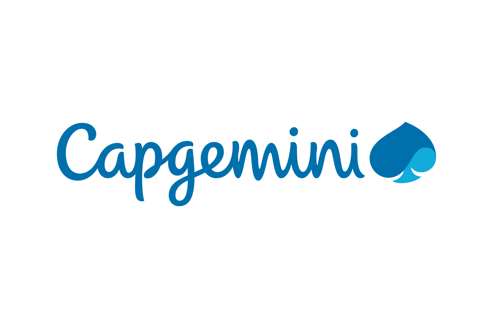

<div align="center">



# AI Product Crafting Lab — Boilerplate LIGHT

### Lab 2 · Product Crafting · Capgemini

**Describe an app in plain words. Watch it get built. In 2 hours. No code, ever.**

**Nothing to install. Double-click `index.html` and you're live.**

<br />

[](#-run-it)
[](#-where-your-data-lives)
[](#-run-it)
[](#-skills)

</div>

---

## ✨ What is this?

The **LIGHT** starter kit for the **Capgemini AI Product Crafting Lab — Lab 2**.

A **senior, non-technical executive** has **2 hours** to build any small app they can imagine. They describe the idea in everyday language to an AI assistant (Codex or Claude Code) — and the assistant builds **all of it**.

This version is made for **locked-down Capgemini laptops**: no Node, no npm, no Python, no server, no terminal needed. The whole app is **one web page** that opens straight from the folder in **Edge or Chrome**, with a real database saved inside the browser.

> **In one line:** you talk, the app appears — and it opens with a double-click.

---

## 🚀 Run it

1. **Unzip** the folder to your computer (right-click the zip → **Extract All**). Pick a normal folder like `C:\Lab` or Documents — **not** inside the zip, and preferably not OneDrive.
2. **Double-click `index.html`.** It opens in Edge or Chrome.
3. You see a blank page with the Capgemini and IQ Project logos saying **Build anything here**: that's your app, ready to grow.
4. **Bookmark it** (Ctrl+D). The `file:///…/index.html` address is your app's link.

**Optional localhost:** `/kickoff` also tries to run the app on `http://localhost` with a tiny server from the `tools/` folder (it tries PowerShell or Perl, then Node, then Python, a few seconds each, and never installs anything). If one works on your laptop, that becomes your app's link; after a restart, double-click **`start-app.cmd`** (Windows) or **`start-app.command`** (Mac). If none works, the app simply opens from the file as above.

Then tell the assistant what you'd like to build, for example:

> *"Build me a mini CRM to keep track of my contacts."*

Each time the assistant changes something, press **F5** on your app's tab to see it.

---

## 💾 Where your data lives

- Everything you add is saved **inside your browser**, on this computer only (in the browser's site storage for this page).
- It's still there after you close and reopen the browser.
- It is **per browser**: data saved in Edge doesn't appear in Chrome. Clearing the browser's site data erases it.
- Your saved data never leaves the browser, unless you add a feature that uses an online service (an AI, for example).

### Export · Import · Reset

The three buttons at the top right of the app:

| Button | What it does |
|---|---|
| **Export** | Downloads all your data as one `.sqlite` file (in your Downloads folder). Keep it as a backup, or open it in **DB Browser for SQLite**. |
| **Import** | Loads a `.sqlite` file you exported earlier. It **replaces** what's currently in the app. |
| **Reset** | Deletes **everything** and starts empty. Export first if you want a copy. |

---

## 🧠 Skills

Type these in the assistant (Codex: `$name` or `/name` · Claude Code: `/name`):

| Skill | What it does |
|---|---|
| **`/diagnose`** | Laptop readiness check for IT / helpers, before the session. Prints a PASS / FAIL report. |
| **`/kickoff`** | Names your app and opens it in the browser. Nothing is installed. |
| **`/givemeideas`** | Four quick app ideas to get started. |
| **`/masterprompt`** | Opens the master prompt maker to write your app's spec. |
| **`/capgemini-ui-design`** | Keeps the app in the Capgemini look. |
| **`/capture-bug`** | Helps describe a problem so the assistant can fix it. |
| **`/iq-project-slides`** | Opens the lab slides. |
| **`/force-filebased`** | *Trainers only.* Forces the app to open from the file. |
| **`/force-serverbased`** | *Trainers only.* Forces the app onto localhost (Mac and Windows). |

Details for helpers: [`SKILLS.md`](SKILLS.md).

---

## 💡 Ideas to get started

1. **🗂️ Personal Mini CRM** — centralize your contacts and track opportunities.
2. **📊 Delivery Risk Cockpit** — spot project delivery risks early.
3. **🔍 Internal Expertise Finder** — quickly find the right experts inside the company.
4. **📝 Proposal Factory** — generate structured commercial proposals automatically.

---

## 🛠️ For helpers

**Before the session:** open the folder in Codex or Claude Code and run **`/diagnose`**. It needs nothing installed and checks: Edge/Chrome present, folder unzipped locally, all files intact, and the app opening and saving data.

**If the app stays on "Loading…"** or says *"site storage is disabled"*: the browser policy blocks saved data for local pages. Try the other browser (Edge ↔ Chrome); otherwise IT must allow site data for `file://` pages.

**Rules for the assistant** live in [`AGENTS.md`](AGENTS.md) (Codex reads it directly, Claude Code through `CLAUDE.md`) and [`GUARDRAILS.md`](GUARDRAILS.md): no installs, no server, no framework, everything goes in `js/app.js` and `js/schema.js`. Online services are allowed only if they work: hard rule, after 5 minutes without success the assistant removes it and sticks to the base boilerplate.

---

## 📁 Project structure

```
.
├── index.html          # The app — double-click to open
├── start-app.cmd       # Windows: start the app the way /kickoff chose
├── start-app.command   # Mac: same
├── tools/              # launch.ps1 / launch.sh (decide + start) and the tiny servers serve.ps1/.pl/.js/.py
├── styles.css          # Capgemini look
├── js/
│   ├── config.js       # The app's name
│   ├── schema.js       # What the app keeps (tables)
│   ├── db.js           # The built-in database (saved in the browser)
│   ├── router.js       # Moving between screens
│   └── app.js          # The screens
├── vendor/sql-asm.js   # SQLite for the browser (do not edit)
├── assets/             # Logo
├── .agents/skills/     # The skills (read by Codex)
├── .claude/skills/     # Claude Code entry points to the same skills
├── AGENTS.md           # The assistant's playbook
├── CLAUDE.md           # Points Claude Code to AGENTS.md
├── GUARDRAILS.md       # Hard limits of this stack
└── SKILLS.md           # What each skill does
```

---

<div align="center">

**Capgemini · AI Product Crafting Lab — Lab 2 · LIGHT**

*Built for people with great ideas, no time to code, and nothing to install.*

</div>
